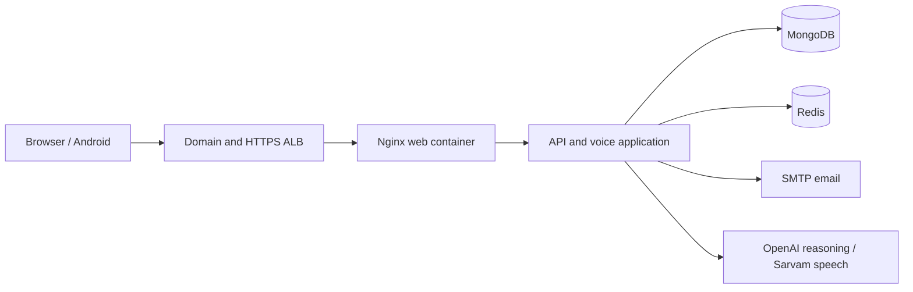

# Docker, MongoDB and private-account SaaS plan

Implementation update (2026-11-21): owner approved this design in prompt 2026-11-20-007. Local Docker/auth/tenant/voice checks and an encrypted cold restore pass; the old AWS deployment is now retired ([verification](legacy-retirement.md)). Owner supplied the existing EC2 stage host; SSH trust confirmation and domain/ALB details remain pending. The pre-approval wording below is retained as the original plan history, not current deployment status. See [operations](docker-operations.md).

Date: 2026-11-20. Source: IDEA-015 and prompts 2026-11-20-002 through 006. This is a planning document, not a deployed design or a completed migration. Requirements and provider choices below are confirmed; backend consolidation and the implementation plan await owner review.

## 1. Decisions and boundaries

The owner selected Docker/Compose, MongoDB, localhost development, later EC2 deployment behind an ALB/domain, public free registration with usage limits, and web plus Android together. Every account is a private personal space; team sharing and roles are outside the first release. Passwords are used for login. Email OTP is used for registration verification and password recovery, not every login. Replace security questions with verified-email recovery and recovery codes.

The owner explicitly selected permanent deletion of existing chats and personal memory. Start the new database empty; do not export or migrate those contents. Existing Cognito accounts will also be retired; users must register again. Historical architecture decisions remain in the repository as history.

This review does not delete resources, alter credentials, implement the replacement, or build new images. The next implementation step needs the owner to choose the proposed design after the remaining questions. Once chosen, deletion is already authorized in principle: prepare the exact project-owned resource manifest and execute the agreed retirement stage without repeatedly asking the same data-disposition question. Stop only for an ownership ambiguity, unexpected dependency or materially broader destructive scope.

Further confirmed choices: SES SMTP in Mumbai; 20 chat turns and 5 voice minutes per verified user per day, one active voice session per user, and a $50/month application AI guard. Use a documented UTC quota-day boundary initially and return reset times to clients. The guard uses conservative reservations and measured reconciliation; provider billing can lag and it is not a guarantee of the final invoice. Hosting/email/storage are separate costs.

The owner explicitly selected OpenAI API for chat/memory, Sarvam for speech, and processing outside Mumbai (prompt 006). This supersedes the earlier Mumbai-only reasoning rule. The intended "ChatGPT key" must be an OpenAI API key with its own billing; a ChatGPT subscription is not API access. Select an available cost/latency-appropriate API model and review account/endpoint data controls during implementation. No OpenAI key is needed for this planning review and no provider call is made.

## 2. Recommended architecture

Use one modular Node.js/TypeScript application for authentication, tenant authorization, chat/memory, speech orchestration and usage accounting. Port the Python domain rules and their meaningful tests; reuse the existing Node Sarvam integration. This is a deliberate port, not an assumption that Lambda code runs unchanged in a container. Keeping Python and Node as separate production services would reduce the initial port but retain two runtimes and a second internal authentication boundary; recommend consolidation for this project's stated simplicity goal.

Reuse the current browser chat/memory/voice UI, adding registration/login/recovery/settings pages and a small Vite build for modules. A React rewrite is unnecessary for this scope. Keep Kotlin for Android and the existing Pixel 8a Android 16+ / friend-compilation arrangement. Replace Cognito flows in both clients; old APKs will stop authenticating when the old stack is retired.

| Compose service | Responsibility | Network/storage |
| --- | --- | --- |
| `web` | Nginx serving the built browser UI and proxying `/api` and `/voice` | Only public application port; no secrets in browser assets |
| `api` | Modular backend, authenticated HTTP and WebSockets, background outbox processing initially in the same application | Internal port; bounded workers and provider connections |
| `mongodb` | Accounts, sessions, conversations, messages, memory, durable usage/outbox records | Private network, authenticated app user, persistent volume; single-node replica set for transaction behavior |
| `redis` | Distributed rate counters, short-lived voice leases, cancellation notifications | Private network, authenticated, bounded memory; no sole copy of durable chat or billing records |
| `mailpit` (dev profile) | Inspect local verification/recovery email without sending mail | Viewer bound to loopback; never included in production |

MongoDB and Redis use pinned upstream images; build custom images for web and API. Do not write Dockerfiles merely to wrap unchanged database images. Production images use multi-stage builds, locked dependencies, non-root runtime users where supported, health checks and explicit resource/log limits. Never mount the Docker socket into the app.



Locally the browser uses one origin such as `http://localhost:8080`; API and voice URLs are relative. The dev override can run Vite behind the same proxy for reloads. On EC2 use `https://<domain>`, with ALB TLS/ACM termination and one EC2 target group pointing at Nginx. One target group is sufficient with this proxy layout; create additional groups only if a later deployment requires independent routing/scaling. Inspect any supplied ALB before modifying listeners or rules. EC2 application ingress is restricted to the ALB security group. No public MongoDB/Redis ports or publicly reachable API bypass.

ALB supports WebSocket upgrades. Configure proxy upgrade headers, bounded buffers, connection draining, and an application heartbeat below the ALB idle timeout. Use HTTP readiness checks and a separate liveness endpoint; a health check does not authorize a request. See [ALB listeners](https://docs.aws.amazon.com/elasticloadbalancing/latest/application/load-balancer-listeners.html), [idle timeouts](https://docs.aws.amazon.com/elasticloadbalancing/latest/application/edit-load-balancer-attributes.html), and [health checks](https://docs.aws.amazon.com/elasticloadbalancing/latest/application/target-group-health-checks.html).

On a real Pixel, `localhost` means the phone. Device development needs a laptop LAN address or an explicit USB `adb reverse` mapping; the friend can configure this when building. Debug-only HTTP exceptions must not enter release builds. Production Android uses the HTTPS domain and the corresponding WSS endpoint. Microphone, backgrounding, audio routing and interruption need actual browser/Pixel tests.

## 3. Repository and configuration shape

Proposed new layout; these files are not created by this planning review:

```text
services/api/                  # auth, tenancy, chat, memory, voice, usage, persistence
web/                           # existing UI moved and adapted, auth/settings pages
deploy/nginx/                  # reverse-proxy and health configuration
deploy/scripts/                # documented idempotent deployment/backup/index tasks
docker-compose.yml             # one static stack; environment values and optional profiles
docker-compose.test.yml        # isolated tests only
docker-compose.restore.yml     # isolated restore only
.env.example                   # tracked placeholders/documentation only
.env.dev                       # ignored local values; generated non-default credentials
.env                           # ignored operator settings; preserve existing Sarvam key
```

Before moving source, record the existing uncommitted work and preserve it. Keep legacy deployment instructions clearly historical, then remove active SAM/CloudFormation workflows from the supported build path once the replacement is accepted. Do not discard the prepared voice work or unrelated tool caches as incidental cleanup.

Config groups: `APP_ORIGIN`, session/auth secrets and expiries; MongoDB URI/database and app credentials; Redis connection; SMTP host/port/TLS/from/credentials; provider region/model/key; per-user/global limits; logging/retention; internal ports. Validate required values at startup, prohibit placeholder production secrets, and fail closed on invalid security configuration. Frontend values are public; never inject provider keys, database passwords or SMTP/auth secrets into Vite variables or Android build config.

Use explicit per-service environment allowlists. Compose's `--env-file` supplies interpolation values; a service's `env_file`/`environment` controls its container environment. Do not give every service the full root file. Document precedence and dev/prod commands; production must not load `.env.dev` or Mailpit by accident. Ignore real `.env` variants while explicitly keeping `.env.example` tracked. Exclude them from image build contexts and avoid printing expanded Compose configuration containing secrets. See [Docker environment configuration](https://docs.docker.com/compose/how-tos/environment-variables/set-environment-variables/) and [precedence](https://docs.docker.com/compose/how-tos/environment-variables/envvars-precedence/).

Use the official server-side OpenAI SDK with `OPENAI_API_KEY` and an explicitly selected model/configuration. Remove active Bedrock runtime dependencies/permissions from the replacement once parity is proven. Do not copy a key to chat, browser assets, APKs, Docker layers or logs. Preserve the existing root `.env` and Sarvam value when adding future settings. File permissions, rotation and backup access still matter when using `.env`. EC2 management/backup permissions, if needed, use a least-privilege instance role; do not add static AWS keys to images.

OpenAI onboarding references: [developer quickstart](https://developers.openai.com/api/docs/quickstart), [API key safety](https://help.openai.com/en/articles/5112595-best-practices-for-api-key-safety), and [separate ChatGPT/API billing](https://help.openai.com/en/articles/9039756-managing-billing-for-chatgpt-and-the-api-platform). The optional OpenAI Developers plugin can help with deeper implementation documentation. Review [data controls](https://developers.openai.com/api/docs/guides/your-data) for the actual account/endpoint/model: `store: false` does not itself remove default abuse-monitoring retention, and Sarvam's owner-confirmed zero-day setting does not apply to OpenAI. Keep the application's conversation state in tenant-scoped MongoDB; do not introduce provider-hosted conversations/files/vector stores without a separate need and retention review.

## 4. Authentication and recovery

Recommend a maintained authentication library, initially Better Auth with its official MongoDB adapter, rather than custom password/session cryptography. First implementation milestone is a small compatibility/security check covering MongoDB transactions, index readiness, OTP verification/recovery, native bearer sessions and revocation. Pin a reviewed release and check its current advisories before adoption. A library is not a substitute for authorization or secure configuration.

- **Register:** name/email/password, public signup throttling and abuse controls, pending account, purpose-bound OTP; no AI/data access before email verification. Return safe generic responses for sensitive account-discovery cases. Consistent canonical email policy, unique email index, password length/blocklist checks and bounded hashing concurrency.
- **Login:** verified email and password, memory-hard password hashing, session rotation and finite expiry. No email OTP on routine login per owner choice. Offer stronger passkey/TOTP protection later; require stronger controls before privileged confidential-secret features.
- **Forgot password:** generic response, short-lived email OTP, strict attempt/resend limits, atomic consumption and a restricted reset credential. It may change only the password; it is not a full session before reset completion. Revoke other sessions, terminate their voice streams and notify the owner after success.
- **Change password:** current password or recent strong reauthentication, rotate/revoke sessions and send notification. Verify a changed email separately; never immediately transfer ownership based only on a claimed address.
- **Recovery codes:** high-entropy, one-use codes shown once after verified enrollment; store only a verification digest. Define issuance, regeneration, atomic consumption, throttling and session invalidation. Check maintained-library support first; do not assume the email-OTP plugin supplies standalone recovery codes. A small reviewed recovery module using standard cryptographic primitives may be needed. Lost-email recovery must not become an unreviewed email-change bypass.
- **Browser:** same-origin HttpOnly session cookie, Secure in production, deliberate SameSite/CSRF/origin enforcement. Local HTTP exception only for development. No bearer token in browser localStorage. Escape untrusted chat/Markdown and apply CSP.
- **Android:** library-supported server-revocable bearer session over HTTPS, protected with Android Keystore-backed storage, finite expiry, explicit sign-out and revocation; no bespoke JWT/refresh system. Native and browser authentication must resolve the same verified user identity.
- **WebSockets:** authenticate before accepting audio, validate browser Origin, never put credentials in URLs, bind immutable user/mode/session context and stop connections when sessions expire or are revoked. Logout must reach active workers; a startup-only token check is insufficient.

Research findings: the [MongoDB adapter](https://better-auth.com/docs/adapters/mongo) supports replica-set transactions but index creation must be checked before admitting public traffic. [Email OTP](https://better-auth.com/docs/plugins/email-otp) covers verification/reset; its documented storage default is plain text, so explicitly select a protected verification representation, cap attempts and test concurrent consumption. Use a keyed digest for low-entropy OTPs if supported by the reviewed configuration. [Password hashing](https://better-auth.com/docs/reference/security) defaults to scrypt; benchmark safe parameters rather than inventing hashing. The [bearer plugin](https://better-auth.com/docs/plugins/bearer) needs deliberate native storage and transport controls.

Security questions have been removed by explicit owner choice. Email verification/recovery proves control of a mailbox; it is not phishing-resistant MFA. NIST distinguishes email validation/recovery from approved out-of-band authenticators; do not label ordinary password/email recovery as high-assurance MFA. See [NIST SP 800-63B-4](https://pages.nist.gov/800-63-4/sp800-63b.html).

Production mail needs sender/domain verification, DKIM/SPF/DMARC configuration, TLS, delivery retries with deduplication, and bounce/complaint suppression. For the selected SES service, verify Mumbai production access: sandbox restrictions prevent general public delivery. Use authenticated submission/TLS, not EC2 port 25. Local Mailpit does not prove production deliverability. See [SES production access](https://docs.aws.amazon.com/ses/latest/dg/request-production-access.html).

## 5. Tenant data model and indexes

For this release one account is one tenant. Set `tenantId` from the verified server-side account identity, never from client JSON, model output or arbitrary headers. No organization/membership complexity now. Shared collections are reasonable for this size, but MongoDB does not supply automatic per-user row isolation: application authorization is a critical boundary.

All personal records carry `tenantId`; conversation/message/fact references also retain mode and provenance. Every repository operation requires a verified tenant context. Query both tenant and object ID; verify a parent conversation belongs to the same tenant/mode before writing messages or facts. Scope lists, updates, deletes, aggregations, exports, async jobs, voice streams and caches. Reject raw Mongo query operators and allowlist filter/sort fields. Neither an index nor a random ID grants permission. Follow [OWASP tenant isolation guidance](https://cheatsheetseries.owasp.org/cheatsheets/Multi_Tenant_Security_Cheat_Sheet.html).

Keep Personal and English Practice isolated within each tenant. Practice must not read/write Personal memory. Treat retrieved memory and model output as untrusted content. Confidential password retrieval remains excluded until its separately approved protection is implemented; existing regex holds are not a secure vault.

Initial query-driven index candidates; confirm field names/types against the chosen auth schema and actual query shapes before creating them:

| Collection/query | Candidate index and constraint |
| --- | --- |
| Users by normalized email | `{ emailCanonical: 1 }`, unique; integrate with the library's authoritative email field rather than creating inconsistent parallel identities |
| Conversation list by mode, newest first | `{ tenantId: 1, mode: 1, updatedAt: -1, _id: -1 }` |
| Messages in one conversation | `{ tenantId: 1, mode: 1, conversationId: 1, createdAt: 1, _id: 1 }` |
| Retry-safe message submission | Partial unique `{ tenantId: 1, conversationId: 1, clientMessageId: 1 }` when a valid client ID exists |
| Pending memory by mode/time | `{ tenantId: 1, mode: 1, reviewed: 1, createdAt: -1, _id: -1 }` |
| All memory by mode/time | `{ tenantId: 1, mode: 1, createdAt: -1, _id: -1 }`; add only if query evidence warrants it |
| Facts derived from a conversation | `{ tenantId: 1, sourceConversationId: 1 }` for owned cascade deletion |
| Sessions | Library-required unique token representation and user lookup; expiry index where supported; review whether the library persists a bearer credential and protect database/backups accordingly |
| OTP/reset/recovery challenges | Unique challenge/credential digest as applicable, purpose/user lookup, single-field `expiresAt` TTL |
| Durable quotas | Unique `{ tenantId: 1, periodStart: 1, metric: 1 }`, plus separately controlled application-wide accounting |
| Outbox jobs | Unique idempotency key; `{ state: 1, nextAttemptAt: 1 }` for bounded retry polling |

Use seek pagination, stable tie-breakers, schema validation and capped message sizes. Dates are BSON dates. A TTL index is housekeeping: explicitly reject expired sessions/challenges even when their document still exists, because [TTL deletion is asynchronous](https://www.mongodb.com/docs/manual/core/index-ttl/). Unique compound/partial constraints must match nullable-field semantics; see [MongoDB unique indexes and validation](https://www.mongodb.com/docs/manual/tutorial/unique-indexes-schema-validation/).

Create and verify indexes through a versioned idempotent setup task before marking the app ready; do not silently continue on a failed unique-index build. Test `explain` using representative per-user data and realistic sorts. Avoid speculative indexes that slow every write. MongoDB has no automatic foreign-key cascade: account/conversation deletion needs an idempotent, tenant-scoped cleanup workflow and clear backup retention behavior.

## 6. Vulnerabilities and maintainability issues

These are migration risks and release requirements, not claims of a newly verified exploit in the running application.

| Priority | Risk / evidence | Required response |
| --- | --- | --- |
| P0 | Existing app was designed for a single owner; moving to public accounts expands every ownership boundary | Tenant-required persistence APIs; two-user negative tests across every operation, cache, job and voice stream; no unscoped ordinary routes |
| P0 | Public signup can multiply paid model/speech/email requests | Verified accounts, per-IP/account throttles, shared voice leases, per-user quotas AND application-wide admission guard; restrict model tokens/audio duration; abuse escalation controls |
| P0 | OTP guessing/replay, reset abuse, email enumeration and account pre-hijacking | Purpose-bound expiring challenges, atomic consumption, attempt limits, consistent responses; reset unverified signup credentials on verified ownership; session invalidation |
| P0 | Long-lived voice sockets can outlive login or reconnect around limits | Shared lease/cancel state, revocation checks, bounded duration/buffering, backpressure, disconnect cleanup and reservation/idempotency tests |
| P0 | Secrets can leak through browser bundles, Docker layers, expanded env/config or logs | Server-only allowlisted config, ignored files/build contexts, no secret build args; redact logs and limit filesystem/backup access |
| P1 | XSS/CSRF, NoSQL injection, forged forwarded headers, Host/reset poisoning | Schema/length validation, safe rendering/CSP, origin/CSRF checks, explicit trusted proxy range/hops and configured canonical origin |
| P1 | Same-host MongoDB and Redis make one EC2 a failure domain | Encrypted persistent volumes, external encrypted backups, restore drill, disk/RAM alarms, documented downtime/recovery goals; never call this highly available |
| P1 | Transactions/async retries can duplicate email, model calls or charges | Durable outbox and idempotency keys; provider calls after commit, bounded retry budgets; atomic quota reservations and reconciliation |
| P1 | Logs, backups and AI memory can preserve deleted personal content | Minimal redacted audit records, no raw audio logging, retention/deletion policy, documented backup expiry; test derived-memory cleanup |
| P1 | Current gateway session ownership is process-local (DEBT-009) | Redis coordination before multiple app workers/replicas; durable billing in MongoDB; fail closed if coordination is unavailable |
| P2 | Python-to-TypeScript port and auth/client replacement can regress behavior | Port domain cases first; contract tests for old Personal/Practice semantics and provenance; adapt both clients before retiring compatibility |
| P2 | Existing speech waits for a full model reply (DEBT-008) | Measure complete turn latency on Pixel/browser; optimize only while retaining ownership, secret holds and quota admission |

Keep backend modules explicit: auth, tenancy, chat, memory, speech, usage, persistence, email/outbox. Publish typed HTTP/WS contracts. Use lockfiles and image pins, migrations/index versions, structured redacted logs, dependency review, backup/restore runbooks and deployment rollback by image tag. Separate readiness from process liveness; do not restart healthy processes merely because a provider is temporarily unavailable.

Compose is suitable for an initial single-host SaaS with an acknowledged downtime risk. It does not add automatic EC2 failover, rolling deployment, database replicas on separate hosts or managed backup. ALB costs continue even with Docker; removing Lambda/CloudFormation does not make hosting free. Review host sizing and monthly infrastructure costs when EC2/ALB details are supplied. Recommend daily encrypted off-host backup for new SaaS data and a restore drill; select explicit recovery targets before public launch. Do not make backups of the old personal data the owner selected for deletion.

## 7. Exact old-deployment retirement plan

Read-only check on 2026-11-20 found 17 resources in Mumbai stack `victor-phase1` and a separate `aws-sam-cli-managed-default` support stack. The processed deployed template confirms `Retain` deletion policies on both `DataTable` and `MonthlyAccountBudget`. Stack deletion alone leaves them behind; [CloudFormation retention policies](https://docs.aws.amazon.com/AWSCloudFormation/latest/TemplateReference/aws-attribute-deletionpolicy.html) explicitly require separate cleanup.

Prepare an ownership manifest immediately before execution, including physical IDs/ARNs and dependencies. In scope: Victor's API Gateway HTTP API/stage, Lambda/permissions, dedicated execution role, log group, Cognito pool/client/domain, retained DynamoDB data table and Victor-created budget. Inspect associated project backups, exports, log copies and SAM deployment objects. A SAM bucket may contain other applications; never empty a shared bucket or delete its support stack based on its name alone. Account-wide budget removal eliminates its alerts; record this consequence rather than silently assuming the budget covers only Victor usage.

Deletion sequence after the design is chosen:

1. Confirm the manifest matches project-owned resources; identify independent copies and any retention constraints. No content export or migration, per the owner's permanent-delete choice.
2. Disable old entry points/jobs and invalidate old sessions to prevent writes during cleanup. Record old URLs/APKs as retired.
3. Inventory DynamoDB backup/PITR/AWS Backup state. A PITR-enabled table deletion can create a system backup retained for 35 days; plan the supported disable/delete procedure before table deletion, inspect resulting copies, and report any provider-enforced retention window. Never claim immediate irreversible erasure merely because the live table is gone. See [DynamoDB deleted-table backup behavior](https://docs.aws.amazon.com/amazondynamodb/latest/developerguide/PointInTimeRecovery_Howitworks.html).
4. Delete the Victor stack, wait for completion, explicitly remove its retained table and budget and project-owned residuals. Stop for unexpected dependencies or ownership ambiguities, not for already answered preferences.
5. Delete only confirmed project SAM artifacts and, if exclusively owned and empty, the corresponding support resources. Preserve unrelated EC2 workloads, ALBs, DNS zones/records, IAM Identity Center and other applications.
6. Re-list exact resources and relevant backups/logs/artifacts, verify old API and sign-in are unavailable, and document any remaining charge/retention items. Billing records and provider-managed service metadata cannot be promised erased by application cleanup.

Fresh-start deletion means no cloud data rollback and a gap in the old app's availability until the replacement is ready. Recommended scheduling: prove local core functionality first, then retire the old deployment before the new EC2 release. If the owner requests earlier retirement, use the same manifest/cleanup checks; data disposition is already explicitly settled. No old resource has been deleted in this planning review.

## 8. Implementation stages and acceptance

| Stage | Deliverables | Completion evidence |
| --- | --- | --- |
| 0. Choose design | Product, limits, SMTP and providers/location selected; approve proposed architecture and sequence | Revised plan and linked tasks; no silent open-choice defaults |
| 1. Local foundation | API/web Dockerfiles, Compose common/dev/prod overrides, env examples/local file, private Mongo/Redis, Mailpit, index setup | Clean build; localhost startup, health/readiness, persistence across restart; no secrets in images/assets; prod config excludes dev services |
| 2. Identity and tenancy | Registration/OTP, password login/change/reset, recovery codes, browser/native sessions, tenant data repositories | Real Mongo/Redis integration tests; expiry/replay/concurrency tests; unverified access rejected; user A cannot read/change/delete/export user B's data |
| 3. Product parity | Chat/Personal memory/Practice isolation, quotas and smooth Sarvam speech; web and Kotlin clients | Source/parity checks, cancellation/mode/logout tests, provider failures, multi-user quota/voice concurrency, browser and friend-built Pixel APK acceptance |
| 4. Operability and security | Restore drill, dependency/image review, redaction, abuse limits, load/latency measurements and runbooks | Representative indexes examined; restart/outage/idempotency tests; agreed load and recovery targets met; no known P0 gaps |
| 5. Retire old deployment | Exact ownership manifest and permanent-delete cleanup above | Stack plus retained/project-owned residuals checked; backup limitations and billing residuals documented; old endpoints fail closed |
| 6. EC2/ALB/domain deployment | Host/workload inventory, role/security groups, persistent encrypted storage, SMTP sender, ACM/DNS/target group/routing, versioned images | Domain HTTPS/WSS, health, signup/recovery delivery, isolation, limits and voice verified; owner accepts web/Pixel behavior |

Stage 6 requires the owner's later EC2 access and domain/ALB details. No existing-instance reuse or listener/DNS change is assumed. Inspect capacity and workloads before deciding host ports or resource limits. Docker startup and a synthetic speech sample are not proof of smooth end-to-end voice; measure microphone-to-transcript and end-of-speech-to-first-playback, interruption latency and reconnect behavior on the actual clients.

Initial launch excludes payments, shared workspaces, autonomous integrations, confidential credential retrieval, ambient recording and wake-word behavior. Existing separately recorded future ideas remain historical backlog rather than implicit MVP commitments.
