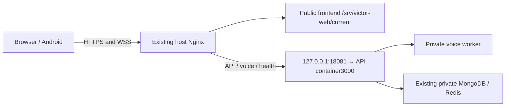

# Proposed host-only Nginx for Victor staging

2026-11-22, [prompt008](../prompts/2026-11-22-008-plan-host-nginx-only.md). Current working staging remains unchanged. The proposed root and API port are **not yet prepared**: do not paste/reload this configuration until readiness is confirmed.

## Target layout



The host takes over static files and the current container proxy routes. There will be no running web/Nginx container after cutover. API, voice worker and databases remain containers. The deployment still uses reviewed Git push/pull and staging-side builds.

This removes the duplicate proxy/serving layer. It does not remove filesystem permissions: the host `nginx` worker must be able to traverse/read published assets. Do not serve from the private Git checkout/home or expose the API publicly. Publish a public build-only directory with0755 directories/0644 files, retaining private env and user data outside it.

## Concrete host settings

Use [ai_test.host-only.conf](../deploy/nginx/ai_test.host-only.conf) **inside the existing HTTPS server block for ai_test.satishk.com**, replacing its old proxy-only `location /` and exact `location = /voice`. Merge matching root/index/header/location directives rather than duplicating them. Keep existing listen/server_name/certificate directives and other sites unchanged. These are site settings, not a replacement global nginx.conf.

The snippet serves `/srv/victor-web/current`, preserves `/api/` when proxying to127.0.0.1:18081, carries WebSocket upgrade headers and360s voice timeout, keeps the existing CSP/microphone/security headers, returns404 for missing worklet/assets, and preserves SPA navigation fallback. It uses directives supported by the checked host Nginx1.22.1, with no new global map/module.

## Ordered migration — not activated

1. **One-time privileged public-root setup:** host inspection confirmed `/srv` is root-owned0755 and `/srv/victor-web` does not exist, with Nginx user/group `nginx` (995/993). Recheck absence/ownership before creation; do not change an unexpected existing directory. Once this path is approved, the scoped command is:

   ```sh
   sudo install -d -o ai_assistant -g nginx -m 0755 /srv/victor-web /srv/victor-web/releases
   ```

   This creates only dedicated public-asset directories; no private-home permission changes or blanket sudo grant. Do not send a sudo password in chat.

2. **Prepare through Git on staging before host reload:** add a host-serving deployment mode; build the frontend using its Node/Vite build stage without an Nginx runtime, publish the build on that same server to a commit-versioned public directory, explicitly normalize/read-check every file and atomically select `current`. Add an API Compose loopback binding `127.0.0.1:18081:3000`. The inspected port is currently unused; recheck at activation. Keep the old web container on18080 available during this transition for rollback. No workstation artifacts/env/database copying.

3. **Readiness gate:** verify API loopback readiness/auth and WebSocket routing, published worklet/asset existence, host-worker read/traverse access and unchanged private API/mode configuration. Existing proxy trust remains one direct host proxy with X-Forwarded-For overwritten from the TLS peer. If a host policy prevents reading/network access, diagnose it and request only the required privileged change.

4. **Owner host edit/reload:** after the gate passes, back up the root-owned host config, edit only this site's HTTPS block using `sudoedit /etc/nginx/nginx.conf`, then:

   ```sh
   sudo /usr/sbin/nginx -t
   sudo systemctl reload nginx
   ```

   Reload only after the complete real config validates successfully. Paste the reviewed fragment into the root-owned config; avoid a root Nginx include pointing directly at an app-writable Git file, which could make later code pulls change privileged configuration without a review.

5. **Public acceptance, then retire web container:** verify root/assets/worklet, security headers, login/cookies, anonymous/origin controls and actual synthetic voice. Only after success, stop the old web container and update future deployment/rollback routines for host-only mode. Keep prior images and asset/API versions; do not remove database volumes or unrelated containers. If cutover fails, restore the site's old proxy routes and old web service before retrying.

## Verification boundaries and remaining decisions

Host user/group, Nginx version, proposed path absence, parent traversal and proposed port availability were inspected read-only. `ss` was unavailable, so the available `netstat` was used; no tool installation attempted. Current public headers include CSP and microphone self policy, with no HSTS observed; existing site/global security directives must still be reviewed when merging headers because older Nginx header inheritance is replaced by lower-level add_header directives.

An unprivileged syntax-only harness is supplied in `deploy/nginx/host-only.syntax.conf`. Passing it validates parsing with the real binary, not readiness of unpublished assets/port, private TLS files or the full host config. The real `sudo nginx -t` and runtime read/access tests remain mandatory at cutover. No host config, published directory, API binding or container has been changed by preparing this proposal.

Primary references: [Nginx static root / try_files](https://nginx.org/en/docs/http/ngx_http_core_module.html#try_files), [WebSocket proxy headers and timeout](https://nginx.org/en/docs/http/websocket.html), [header inheritance](https://nginx.org/en/docs/http/ngx_http_headers_module.html#add_header). Runtime boundaries/worker behavior remain in the current app; this serving change alone does not alter voice turn handling or model latency.
