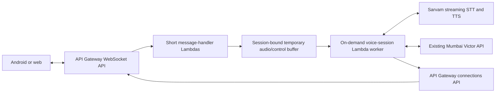

# API Gateway voice alternative - 2026-11-20

**Conclusion:** EC2 and an always-on container are not mandatory. API Gateway WebSocket APIs plus on-demand Lambda compute are a credible alternative for this private app. This is an architecture proposal, not a completed prototype or deployment.

The existing Victor API is an HTTP API. It remains suitable for chat, authentication-protected data, and memory. It does not become a duplex voice connection by selecting a Sarvam streaming SDK. AWS documents response streaming for REST APIs, not HTTP APIs, and does not support streamed requests through that feature. [AWS response streaming](https://docs.aws.amazon.com/apigateway/latest/developerguide/response-transfer-mode.html).

## Proposed serverless shape

API Gateway manages the client connection and routes messages. A separately invoked worker holds Sarvam's upstream sockets while the user has an active voice session. Short handlers deliver audio/control packets through a bounded, ordered session buffer; the worker sends transcripts and audio back through the connections API. API Gateway is the managed front door, not the process running the SDK. Worker invocation must be asynchronous/separate from an individual route integration.

The buffer and session lease require a concrete design/prototype. Do not assume a shared SQS queue can route each session to its matching worker, or that different Lambda invocations share memory/socket state. Temporary raw-audio retention, ordering, deletion, authentication, duplicate events, abrupt disconnects and abandoned-session cleanup must be tested. Sarvam keys stay server-side. No existing EC2 instance needs to be changed for this proposal.

## Limits that matter

- An API Gateway WebSocket client connection can last two hours, but each backend integration has a maximum 29-second timeout. That is not a 29-second limit on an entire voice conversation. [WebSocket quotas](https://docs.aws.amazon.com/apigateway/latest/developerguide/apigateway-execution-service-websocket-limits-table.html).
- A conventional Lambda invocation can run up to 15 minutes, so the existing five-minute voice session limit fits an active worker. The worker is billed for its invocation duration, including time waiting for audio or external APIs. It must terminate on stop/disconnect/expiry. [Lambda quotas](https://docs.aws.amazon.com/lambda/latest/dg/gettingstarted-limits.html).
- Incoming binary WebSocket frames are not supported. Both clients currently send binary PCM; an API Gateway version must instead send base64 text/JSON and respect frame limits. Current capture frames are small enough after encoding, but larger outbound speech chunks need splitting. [Binary-frame behavior](https://docs.aws.amazon.com/apigateway/latest/developerguide/websocket-api-develop-binary-media-types.html).
- Lambda Web Functions are not a drop-in host for the existing Node WebSocket server either: they do not support inbound WebSocket upgrades and their HTTP request/response path is half-duplex. [Web Function networking](https://docs.aws.amazon.com/lambda/latest/dg/web-functions-networking.html).

## Cost and smoothness

API Gateway WebSocket billing depends on messages and connection minutes. Add Lambda, buffer/storage and Sarvam charges. This avoids the previously quoted always-on Fargate/ALB base, but is not automatically free or guaranteed cheaper for every packet rate. [API Gateway pricing](https://aws.amazon.com/api-gateway/pricing/).

At this owner's intermittent personal usage, an on-demand design is worth prototyping before accepting new always-on hosting. This is an engineering recommendation; total cost and response quality are not yet measured. Extra routing/buffering, cold starts, response chunk posting and teardown may affect latency. Compare actual end-of-speech-to-first-audio and interruption behavior with the current streaming gateway before choosing the production architecture. The existing 692ms synthetic TTS measurement does not validate this new route.

The previous recommendation focused on deploying the already-written persistent server; treating that hosting shape as mandatory was too narrow. Existing gateway code remains available, but no serverless transport refactor or resource creation has been made in response to this question.

## Privacy confirmation

On 2026-11-20 the owner confirmed Model APIs retention is No retention (0 days). Record this as owner-confirmed; the agent did not inspect the Sarvam account UI. Do not ask for the same confirmation again. Apply the production privacy-confirmed setting when an approved deployment is prepared. The key remains in the private root .env and no personal microphone test has occurred.
