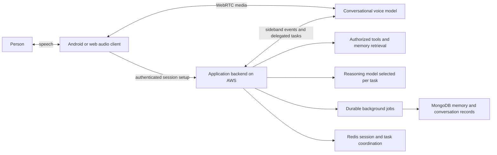

# Stage 3: recommended architecture and engineering practices

Date: 2026-11-21. This is a proposed design, not an approved migration or implemented change.

## Recommended architecture to test first

Use a **local audio client + continuous native conversational voice + independent application backend**. For this repository, first test GPT-Live 1.1 with WebRTC and server-controlled client delegation. Compare Gemini 3.8 Live and OpenAI Realtime 2.1 before choosing a provider. The architectural advantage is overlapping conversation with reasoning/tools; this is an inference from documented capabilities, not evidence that GPT-Live is the fastest model.

This diagram depicts the OpenAI Live candidate. Google Developer Live uses direct WebSocket media and its own token/tool events, not OpenAI's sideband protocol. AWS Sonic generally needs an application media bridge into Bedrock's bidirectional event stream. Do not implement one vendor's control events against another vendor.

Direct media avoids carrying every sample through the application's general HTTP/chat route. It does not eliminate the provider media server, possible TURN relay, or internet transit. Compare direct and relayed routes empirically; provider access and app policy can justify a relay. [OpenAI WebRTC](https://developers.openai.com/api/docs/guides/voice-webrtc), [Google connection options](https://aistudio.google.com/docs/live-api).

## Concrete combinations worth building

| Candidate | Mobile/web media | Conversation and intelligence | Server role |
|---|---|---|---|
| A: preferred first prototype | Native Android WebRTC and browser RTCPeerConnection | GPT-Live 1.1 frontend; existing text assistant through client delegation | Session creation, sideband, owned context, tool execution, durable task state |
| B: Google challenger | Developer API direct WSS; separate Firebase Kotlin/web trial if advantageous | Gemini 3.8 Live; async function calls; stronger backend only when necessary | Short-lived constrained tokens or managed SDK path, authorized tools, persistence |
| C: simpler native control | Direct WebRTC | OpenAI Realtime 2.1 handles audio/reasoning/tools | Session policy, private tool executor, memory |
| D: independent streaming cascade | LiveKit WebRTC and persistent Node worker | Deepgram Flux -> streamed text model -> Cartesia Sonic 3.6; swap TTS with ElevenLabs/Sarvam | All orchestration, speculative turn state, text validation and playback cancellation |
| E: AWS challenger | WebRTC to a persistent media worker | Nova 2.5 Sonic via bidirectional runtime stream | Region-aware bridge, IAM-scoped model access, tools and records |
| F: managed references | Supported WebRTC/client SDK | Azure Voice Live; ElevenAgents native Mini/Max; Deepgram Voice Agent | Authenticated tool integration and evaluation exports |

Pin supported SDK versions during an experiment. Verify actual plugin support for the selected model; the installed OpenAI SDK and current Sarvam adapters do not establish GPT-Live, LiveKit or Gemini compatibility. No Kotlin/React rewrite is inherently required.

For the reasoning backend, compare the current model with a fast capable model and a higher-quality model at appropriate available service tiers. Do not route every easy conversational turn through maximum reasoning. A costly model can be the correct choice for a difficult task and still have an undesirable first-answer delay. Groq/Cerebras belong in text-stage experiments, not in an assumed universal replacement. [Groq measurement guidance](https://console.groq.com/docs/production-readiness/optimizing-latency), [Cerebras streaming](https://inference-docs.cerebras.ai/capabilities/streaming).

## Audio and interaction practices

1. **Make immediate controls local.** Stop, mute, playback flush, microphone indicators and permission state should respond on the device. A spoken local stop recognizer may supplement this if it is reliable; the stop button must work independently of recognition or connectivity.
2. **Keep input and output active together.** Turning off capture whenever TTS plays prevents genuine interruption. Use echo cancellation and test the speaker path; double-talk behavior matters more than a clean headset demo.
3. **Start from the transport's audio stack.** WebRTC supplies media timing, jitter handling and codec negotiation. Use its tested Android capture/playout path first. For a custom PCM implementation, measure AudioRecord/AudioTrack; investigate Oboe/AAudio if device latency demands it. Keep network I/O and allocations out of real-time callbacks. Android's game-oriented example numbers are device examples, not assistant guarantees; select a voice-communication use case rather than copying GAME audio attributes. [Android low-latency guidance](https://developer.android.com/games/sdk/oboe/low-latency-audio), [AEC API](https://developer.android.com/reference/android/media/audiofx/AcousticEchoCanceler).
4. **Resample deliberately.** Let WebRTC negotiate media. For PCM APIs, convert correctly at the boundary: Google Live documents 16 kHz mono PCM16 input and 24 kHz output; current Sarvam uses the same nominal rates. Avoid repeated resampling and container/codec conversion. Maintain correct timestamps and byte order.
5. **Do not apply one frame rule to every API.** Small audio frames can reduce accumulation delay, but provider recommendations differ. Amazon Transcribe recommends uniform chunks of 50–200 ms; codec frames and provider batch chunks are different layers. Follow the selected API, then measure pacing and CPU. [Transcribe stream guidance](https://docs.aws.amazon.com/transcribe/latest/dg/streaming.html).
6. **Tune endpointing with pauses, corrections and accents.** A 100 ms silence threshold can sound fast while repeatedly interrupting a speaker. Compare semantic/acoustic turn detection and manual controls; do not combine device, framework and provider silence waits accidentally. Google/Realtime/Flux expose different controls. [OpenAI semantic VAD](https://developers.openai.com/api/docs/guides/realtime-vad), [Flux settings](https://developers.deepgram.com/docs/flux/configuration).
7. **Distinguish a backchannel from a cancellation.** “Mm-hmm” may mean continue; “stop” or a correction may require yielding. Full-duplex candidates need overlap tests, not just a binary microphone-active test. In a custom cascade, implement false-interruption recovery only with known conversation state. [LiveKit tuning](https://docs.livekit.io/agents/logic/turns/tuning/).
8. **Keep sessions warm during an active conversation.** Pre-create permitted connections and load voice/context before the user finishes the first request. Measure cold and warm separately. Do not hold the microphone open outside the chosen session or hide a loading delay behind a ready indicator.
9. **Use short, complete first answers.** Give the useful first clause and elaborate when needed. “Let me think” is measured as acknowledgement, not a useful answer. For difficult tasks, a truthful progress statement may improve conversation without reducing task completion time.
10. **Use bounded adaptive playout buffers.** A large queue defeats quick synthesis; too little buffering causes stutter. Observe underruns and acoustic onset. Bluetooth routes deserve their own results; paying for a faster model does not remove accessory buffering.

## Streaming cascade practices

Stream recognition while speech arrives, optionally start **cancellable, read-only** speculation when turn confidence is sufficient, then stream speakable clauses from the model into streaming TTS. Flux explicitly provides eager turn events and resumed-turn cancellation; use that contract rather than launching a new irreversible action on every partial transcript. [Eager EOT protocol](https://developers.deepgram.com/docs/flux/voice-agent-eager-eot).

Do not feed a partially generated JSON document into TTS. Create a distinct spoken-content stream with a defined validation policy; produce facts/structured metadata separately. Buffer at clause/punctuation boundaries with a maximum wait, and tune the TTS provider's own buffering/flush behavior. Token-by-token flushes can degrade pronunciation, intonation and continuity. [ElevenLabs streaming](https://elevenlabs.io/docs/eleven-api/guides/how-to/websockets/realtime-tts), [Polly flush behavior](https://docs.aws.amazon.com/polly/latest/dg/bidirectional-streaming-lifecycle.html).

Every queued text/audio chunk needs session, conversation, mode and generation identity. On interruption, flush local playback immediately, signal upstream cancellation, and ignore late obsolete chunks. Update conversational history to reflect what was actually heard. Realtime WebRTC handles server truncation; custom WebSocket playback needs explicit client tracking. [Realtime interruption/truncation](https://developers.openai.com/api/docs/guides/realtime-conversations), [Cartesia contexts](https://docs.cartesia.ai/api-reference/tts/websocket).

## Separating reasoning, tools, and memory

Keep only work needed for a correct next spoken clause on the critical path. Context retrieval for a memory question remains necessary. Memory extraction after an ordinary reply, indexing, analytics, embeddings and diary-style summaries are candidates for background execution.

This changes the current synchronous reply/facts behavior and needs owner approval before implementation. Preserve the earlier immediate-memory intent through explicit state: a fact is pending until durably committed; a subsequent memory-dependent turn waits on its relevant pending write or reads a validated pending view. Do not tell the user “saved” before persistence succeeds. Preserve provenance, user correction/deletion and Practice isolation.

A conversational frontend can speak while a backend operates, but it must not guess an unavailable tool result. Return grounded, concise results. Parallelize independent read-only retrievals; respect dependencies and confirmations for actions. Use idempotency keys so replayed events do not duplicate an action. Audio interruption and task cancellation are separate state changes: an already-executed action does not become undone when speech stops. [GPT-Live delegation](https://developers.openai.com/api/docs/guides/live-delegation), [server controls](https://developers.openai.com/api/docs/guides/voice-server-controls?api=live).

## Application controls that must survive a faster media path

The backend creates a user-owned session bound to tenant, mode and conversation. It authorizes tool calls and memory lookups, enforces session revocation, and records task status. Credentials remain on the server; clients receive short-lived access or the negotiated session connection. A browser UI flag is not authorization.

A direct cloud audio path uploads speech before a server transcript checker can inspect it. It cannot satisfy an absolute rule that sensitive speech must be detected before any cloud model receives it. Existing confidential retrieval/passkey/offline-speech requirements need a separate protected path and explicit design review. Synthetic ordinary conversations are sufficient for the initial comparison.

For spoken output that must be approved before it is heard, choose provider-supported playback gating or a controlled media buffer. An asynchronous transcript monitor alone cannot retract audio already played. Account for that gate in latency results; native audio changes where content control is possible. Research recommends capability tests, not weakening application controls for a better latency chart.

## Hosting and multi-cloud placement

Keep general application state/tools on the approved AWS backend initially. Place any media worker near the provider route and compare at least two viable placements. Keep DB, Redis and synchronous tools near each other; avoid a cloud hop per tiny audio or text fragment. Establish persistent connections and observe CPU saturation, event-loop lag, queue depth and provider admission.

An always-warm worker is worth evaluating because experience is the priority. Infrastructure choice follows measurement: direct media can avoid a worker; a framework worker can improve resilience at the cost of an extra route. An SFU, Kubernetes, agent framework, or a premium plan is not intrinsically necessary for a one-person fast conversation.

Use Google + OpenAI + AWS only where each component has a demonstrated benefit. A useful combination is AWS application state plus OpenAI or Google native voice. Splitting STT, LLM and TTS across three clouds is justified only by full-chain measurements and quality, not provider reputation.
