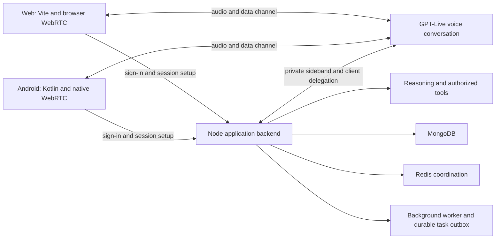
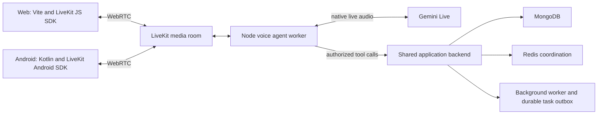

# Two architecture plans: backend-owned assistant, native clients

Date: 2026-11-21. Status: proposed; testing demos authorized separately in prompt 014. Neither provider plan is finalized. Individual conversation experience is the priority; cost is informational.

## Responsibility split shared by both plans

Your proposed split is correct with one refinement: the backend defines agent instructions and enforces business rules, while a cloud voice model still makes real-time speech/turn decisions. Clients own their user interface and local media controls. A prompt alone cannot enforce database permissions or guarantee spoken behavior.

| Layer | Ownership and proposed stack |
|---|---|
| Domain/backend | Existing TypeScript/Node service, server-owned persona/policy versions, tools, retrieval, task orchestration, authentication, permission checks and session revocation |
| Durable state | Existing MongoDB: accounts, conversations, source-linked messages/facts, task state, session metadata, outbox/events; no client database credentials |
| Coordination | Redis for expiring leases, presence and wake-ups; MongoDB task/outbox records remain authoritative across restarts |
| Background work | Node worker: extraction/indexing and slow tools; idempotent task handling and retry state; not every conversation turn needs a multi-agent loop |
| Web | Keep existing Vite/browser UI; add a focused voice session controller and the chosen transport SDK. React is optional, not required for voice |
| Android | Keep Kotlin and existing native UI; add native media transport and Android audio-focus/lifecycle handling. Compose is optional, not a required rewrite |
| Shared contract | Authenticated conversation/mode IDs, capability negotiation, caption/state events, tool/task status, stop/mute/reconnect semantics and consistent deletion/memory behavior |

The clients can choose different libraries and rendering approaches, but they cannot independently choose incompatible agent policy, memory rules or provider protocols. Backend capability negotiation selects a transport/profile supported by the installed client version. Client SDK freedom does not mean clients choose arbitrary providers with a production API key.

## Plan A: recommended for the desired continuous conversation

**OpenAI GPT-Live 1.1 + direct WebRTC + independent backend agent on AWS.** This is the first design to test, not a measured speed winner.

The backend negotiates the session using its API key and server-owned configuration. Media goes directly between the client and OpenAI. A private server-side WebSocket observes transcript/delegation events and returns authorized results. GPT-Live manages spoken interaction while the backend can use a separately selected reasoning model or deterministic tool. [Live architecture](https://developers.openai.com/api/docs/guides/live), [client delegation](https://developers.openai.com/api/docs/guides/live-delegation), [private server controls](https://developers.openai.com/api/docs/guides/voice-server-controls?api=live).

### Concrete components

- Web: browser `RTCPeerConnection`, media tracks, data-channel events and existing Vite UI. Keep raw provider events behind a browser voice-controller module.
- Android: Kotlin and a maintained native libwebrtc distribution/binding. Select and pin that dependency during the Android spike; this plan does not assume an official OpenAI Kotlin voice SDK or an already-vetted Maven artifact.
- Backend: current Node application plus a Live session adapter, transcript/task coordinator and shared domain tools. Use client delegation to preserve backend context/routing ownership. “Client delegation” is the provider's term; the delegate runs on our server.
- Reasoning: retain the current OpenAI adapter initially, then compare fast/capable models per task. Return concise grounded results directly to the voice frontend; avoid an extra rewrite-model call.
- Storage/hosting: retain MongoDB/Redis and existing Docker/AWS deployment initially. Isolate voice sessions from ordinary request lifecycle; split a long-lived orchestrator process only if reliability/load requires it.

### Turn flow

1. The signed-in client requests an owned Personal or Practice session; backend checks supported version/mode and loads minimal permitted context.
2. Backend creates a configured Live session and attaches its event/control connection; the client activates media after setup is ready.
3. The voice model handles ordinary conversational exchanges. It delegates tasks requiring records/tools/reasoning; it does not access MongoDB itself.
4. Backend builds each task from transcript history and current state. Delegation metadata alone does not contain the user's task text. Reject stale work, apply authorization, and execute once per idempotency key.
5. Voice conversation can continue while the task runs. Only verified results return for speech; a progress phrase is not task completion.
6. Persist transcript/task state and process eligible memory work separately. Block a subsequent memory-dependent read on its relevant pending write if necessary; say “saved” only after commit.

### Pros

- Explicit full-duplex voice and independent reasoning closely fit the owner's desired interaction.
- Direct media avoids an application audio relay for the normal speech path.
- Backend can evolve tools, model routing and memory independently of voice rendering.
- Reuses the current backend, database and Kotlin/web investment.

### Cons

- Android direct WebRTC integration and lifecycle behavior require a real native spike.
- Sideband/delegation context, reconnects and action-versus-speech cancellation add state-management work.
- OpenAI-specific session/event/voice behavior creates adapter dependence; another provider is not a drop-in model-name change.
- Direct model audio is not fully inspected by the backend before it reaches the model or speaker. Protected confidential flows require a compatible separate design; async transcript monitoring cannot retract played speech.

## Plan B: secondary, framework-managed media and Google native audio

**LiveKit Cloud media + LiveKit Agents Node worker + Gemini 3.8 Live + the same domain backend on AWS.** Use LiveKit's managed media initially for evaluation rather than self-hosting an SFU immediately.

The media worker owns the model session, tools and provider events. Gemini handles native speech and ordinary conversational reasoning; backend tools remain authoritative for records/actions. Slow tasks can use the backend reasoning service when needed, without calling an additional text model on every simple turn. The worker bridges media into Google's Live API rather than assuming Google provides OpenAI's private sideband protocol. [LiveKit Gemini integration](https://docs.livekit.io/agents/models/realtime/gemini/), [agent sessions](https://docs.livekit.io/agents/logic/sessions/), [Gemini tool protocol](https://aistudio.google.com/docs/live-api/tools).

### Concrete components

- Web: `livekit-client` with the existing Vite UI and a provider-neutral session controller.
- Android: Kotlin with `io.livekit:livekit-android`; preserve existing views initially. LiveKit's native Android SDK and starter exist; an Android UI rewrite is not necessary. [Android SDK](https://docs.livekit.io/transport/sdk-platforms/android/).
- Voice worker: Node with `@livekit/agents`; use the documented Gemini integration. Prefer direct Google plugin/billing where supported and feature-complete; compare LiveKit Inference if useful. Pin exact model/plugin capabilities during the spike.
- Backend: issue scoped room participation grants, bind room/worker to user/mode/conversation, and expose internal authorized tools. No database or tool credentials in the browser/app.
- Google: `gemini-3.8-live` native audio with async tools. The model itself can perform everyday reasoning; complex work delegates through the same backend task contract.

Firebase AI Logic is not the baseline for this plan: its Live feature remains preview and the current quickstart does not establish Gemini 3.8 support. Using Google's API through a server worker avoids assuming SDK/model parity or migrating existing app identity to Firebase. [Firebase current support page](https://firebase.google.com/docs/ai-logic/live-api/).

### Pros

- Documented web and native Android media SDKs reduce application-specific transport work.
- A server-owned voice session provides a consistent place for tools, provider event processing and transcript handling.
- Gemini offers native audio and async tools without forcing separate STT and TTS products.
- The framework boundary gives more room to change model providers or later evaluate a specialist cascade; each still needs its own adapter and tests.

### Cons

- Adds LiveKit media service and a long-running agent worker to operate and observe.
- The extra media path can add latency; its practical resilience benefits and total timing must be measured on the actual network.
- Plugin support can lag new model features; billing/auth differ between the direct Google plugin and LiveKit Inference.
- Model, voice and tool behavior differ from Plan A. Protocol translation and context continuity require testing; switching mid-session is not promised.

## Choosing between them

| Criterion | Plan A | Plan B |
|---|---|---|
| Main design goal | Continuous voice frontend with independent backend intelligence | Consistent media SDKs and a server-managed Google voice agent |
| Main audio path | Client -> OpenAI | Client -> LiveKit -> agent worker -> Google |
| Client transport effort | Browser straightforward; Android integration needs validation | LiveKit JS and Android SDKs |
| Backend control | Domain policy/tools plus Live sideband/delegation | Domain policy/tools plus server-owned agent worker |
| Everyday reasoning | Voice frontend plus delegation as needed | Gemini native audio agent, tools as needed |
| Provider portability | Explicit application adapters; OpenAI event-specific voice layer | Framework plugins help; parity and migration still require work |
| Latency conclusion | Strong first candidate; unmeasured on Pixel | Strong challenger; extra route and SDK benefits must be measured |

**Recommendation:** begin with A as the experience hypothesis and B as the serious alternative. Keep the shared domain/state contracts identical. Do not build two separate account/memory systems or assume the more expensive plan is better. Use the same 30-scenario benchmark and judge useful answers, pause handling, interruptions and owner preference.

## Proposed implementation sequence and acceptance gates

1. **Demo and capability spike:** separate local lab, both architecture screens and explicit simulation labels; one synthetic provider smoke check where configured. No production database access.
2. **Shared backend contract:** session ownership, immutable mode, agent profile version, task events and pending/committed memory semantics. Acceptance: cross-user/mode/replay/revocation tests pass.
3. **First web vertical slice:** native audio session, transcript, stop/mute, tool lookup and controlled slow task. Acceptance: actual provider audio and tool evidence; no fictitious task completion.
4. **Android vertical slice:** selected native transport, speaker/headset focus and lifecycle cleanup. Acceptance: APK builds and Pixel microphone/playback/interruption works.
5. **Controlled comparison:** both candidates under matched conditions, with acoustic timing. Targets remain p50 useful answer <=700 ms and p95 <=1,200 ms for simple warm turns, not guarantees.
6. **Owner selection and rollout:** provider/architecture decision after review; stage deployment behind a feature flag, observe, and preserve a text fallback. No automatic failover that repeats actions or claims seamless live-context transfer.

These are proposed tasks inside this plan. The architecture idea remains Discussing; no new implementation milestone or debt is marked complete by writing the plan. Demo authorization permits the local prototype work; production migration is a separate step.
