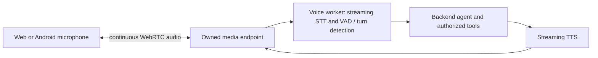

# Own realtime voice server: terminology and design

Date: 2026-11-21. IDEA-017, Discussing. This is a separate architecture option, not a replacement decision or build authorization.

## What this server is called

The whole application is reasonably called a **realtime voice agent server**, **voice gateway**, or **voice orchestration backend**. If clients send audio over WebRTC, its transport component is a **WebRTC media server/endpoint**. WebRTC transports media; speech detection and agent reasoning are separate processing stages.

| Component | Job |
|---|---|
| Client microphone/audio stack | Capture speech with permission, manage echo/noise, play/stop replies |
| WebRTC media layer | Negotiate and transport live audio between client and server |
| Voice activity detection (VAD) | Estimate which audio frames contain speech; derive speech-start/stop events with timing rules |
| Turn/end-of-utterance detection | Estimate whether a pause means the person has finished the conversational turn |
| Streaming STT | Convert incoming speech into provisional/final text for a text-based agent |
| Agent orchestrator | Supply context, run reasoning/tools and manage task/turn state |
| Streaming TTS | Convert reply text progressively into audio |

A one-user assistant does not inherently need a multiparty SFU. An SFU routes media; a TURN server relays connectivity when needed. Neither is a speech-understanding engine. A framework/server can package several roles, but they remain distinct.

## Feasible owned architecture

The browser/phone captures the microphone; the backend receives what the client sends. It does not remotely open a phone microphone. Keep receiving audio while replies play so the user can interrupt, with client echo cancellation and immediate local stop controls.

Do not wait for speech end before opening every connection or uploading the complete recording. Keep STT and relevant model connections warm, stream while the user speaks, and use turn detection to decide when to respond. Read-only speculation may begin early with cancellation; irreversible actions still require final intent/authorization. A native audio model is another branch: feed it live audio without a mandatory external STT/TTS chain, using only the turn-control mechanisms that model supports.

## Speech stop is not thought completion

“Remind me on Friday ... at six” contains silence before the request is finished. VAD finds speech activity; a turn detector adds acoustic/linguistic context to reduce premature answers. Neither predicts intent perfectly. Preserve a small pre-speech buffer so the first syllable is not cut off, tune pause tolerance, and clear obsolete output immediately on a real interruption. Avoid stacking multiple independent endpointing waits.

[LiveKit's turn documentation](https://docs.livekit.io/agents/logic/turns/) describes VAD, endpointing and turn models separately. [Pipecat Smart Turn](https://docs.pipecat.ai/api-reference/server/utilities/turn-detection/smart-turn-overview) documents semantic/acoustic completion detection with a local ONNX implementation. These are existing capabilities to evaluate, not models we need to train from scratch.

## Proposed stack to evaluate

Use **self-hosted LiveKit for WebRTC media + an owned voice worker + Silero VAD and a compatible turn detector**, connected to the existing backend agent. Retain MongoDB/Redis/domain policy. Choose streaming speech providers or a native audio adapter separately; self-hosting transport does not require self-hosting all AI models.

[Silero VAD](https://github.com/snakers4/silero-vad) provides pretrained speech activity detection. [LiveKit self-hosting](https://docs.livekit.io/transport/self-hosting/) supports running the media server and agent workers on owned infrastructure. The self-hosted offering does not include Cloud's built-in inference service; bring provider keys or separately operate models. This would be a self-hosted variant of Plan B, with VAD/turn logic explicitly under our control.

Benefits: server-owned turn/cancellation policy, reusable web/Android behavior, and independent provider/model choices. Costs/tradeoffs: an additional media hop, packet/buffer/echo tuning, network connectivity/relay setup, worker capacity and operations. More control does not establish lower latency; compare with direct native voice on actual networks before selection.

Open questions: whether to own only transport/turn logic or also STT/TTS/model inference, which turn detector matches the selected runtime, whether to use server versus hybrid local interruption detection, and actual measured latency/false-end rates. Existing architecture selection and provider setup remain open separately. No subscription, infrastructure, code or data changes made for this idea discussion.
