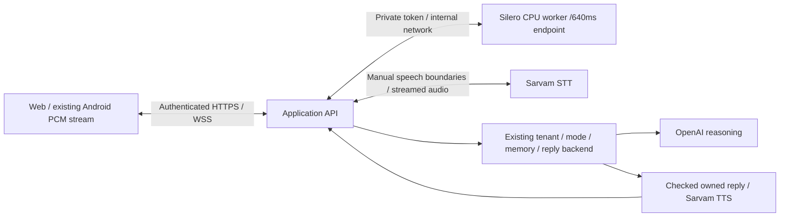

# Owned speech detection integrated on staging

2026-11-21. IDEA-017 / TASK-019. Authorized by [prompt020](../../prompts/2026-11-21-020-integrate-owned-voice-on-stage.md); diagnosed repairs explicitly approved in [prompt021](../../prompts/2026-11-21-021-approve-owned-voice-integration-repairs.md).

**Live:** https://ai_test.satishk.com — sign in normally and choose **Start voice** in Personal or English practice. Existing Android clients retain their audio/control protocol and staging API URL. Actual Android/Pixel acceptance is pending.

## Deployed increment

The standalone [POC](owned-server-poc/README.md) proved actual WebRTC locally. This first **app/staging** increment uses existing WSS PCM, with no new public UDP/TURN/STUN routing. Backend speech decisions now belong to our private worker. The Node adapter sends active speech plus288ms pre-roll to Sarvam and supplies manual start/end messages. Only the application API has provider credentials; the worker has a separate private token, no database access and no published port.

The app retains signed cookies/native tokens, tenancy and conversation ownership, Personal/Practice separation, secret holds, usage reservations, persistence and owned-reply speech checks. Public clients cannot nominate an arbitrary agent or worker URL. Interrupted generations discard stale replies; the adapter suppresses final transcripts superseded by a later speech start. UI displays detected speech and the640ms pause. This is silence-based endpointing, not semantic thought completion.

**Follow-up,2026-11-22:** That initial suppression of delayed finalized transcripts caused input loss across pauses. [Repair14](14-paused-facts-retention-repair.md) now preserves those statements and accepted input processing while cancelling obsolete assistant output. Current staging is the newer source-hashed release in that report; this section records the original increment.

Full streamed reasoning from the research adapter has **not** replaced the app’s checked reply/persistence gate. That performance/policy change remains a further increment. This release establishes owned turn detection within the real app without bypassing its data/agent boundaries.

## Release and checks

- Current images: `victor-api:stage-owned-ace419520ce9`, `victor-web:stage-owned-ace419520ce9`, `victor-voice-worker:stage-owned-ace419520ce9`.
- Build source SHA-256: `ace419520ce9263030f490a82c5ee846cc7f497a45860bf2edd2cda4753425a9`. Subsequent documentation edits do not change those deployed runtime artifacts. This is a local working-tree source build, not a newly pushed Git commit.
- Three image-layer fingerprints matched after SSH transfer. Versioned private env backup/release pointer retained. New worker and app containers healthy; MongoDB and Redis kept their17/18-hour uptime. Host Nginx, security rules, unrelated services and databases unchanged.
- 28 isolated app/auth/tenant/voice checks passed. Three worker checks passed, including a real synthetic phrase, silence rejection, token enforcement, full 3200-byte frame acceptance and socket cleanup. Corrected web mute/unmute wire contract passed separately; API unchanged since its full suite.
- Public native-style signed-in WSS test passed complete transcription, correct156 response, backend start/end and149760 bytes of non-silent PCM (peak24931). First PCM was3978ms after sending the final synthetic input chunk in that single run, **including endpoint wait**. [Raw synthetic evidence](owned-server-poc/evidence-staging.json).
- An isolated browser context signed in through the normal form, streamed the AI-generated phrase through the actual app worklet/WSS, received the156 reply, scheduled nonzero TTS PCM (peak0.71185), toggled mute/unmute without disconnect, and stopped capture. Secure/HttpOnly cookie, anonymous config401, anonymous private profile401 and foreign-origin POST403 checked. Worker without its token returned401; health200. [Browser evidence](owned-server-poc/evidence-staging-browser.json).
- Desktop1440/mobile390 screenshots visually reviewed; no horizontal overflow: [desktop](owned-server-poc/screenshots/staging-signed-in.png), [mobile](owned-server-poc/screenshots/staging-mobile.png).
- Exact ephemeral test account and its app/session/conversation/memory/quota records removed and absence verified. No test email sent, other accounts untouched, global spend accounting retained. QA contexts/broker closed; isolated local test containers stopped with volumes preserved. Real provider keys absent from checked source/build artifacts.

## Failed observation and scoped repairs

The initial release `stage-owned-ee7cec7acafd` was healthy at the container level but voice disconnected. Read-only tracing isolated worker close1009: the installed aiohttp parser rejects a frame whose payload equals `max_msg_size`; both web/Android produce3200-byte frames and the initial worker limit was3200. [Initial failure](owned-server-poc/evidence-staging-initial-failure.json) is preserved.

After explicit approval, transport cap became4096 while application validation remains3200; a full-frame WebSocket regression passed. An independently discovered existing browser mute mismatch (`muted` vs backend `value`) was also approved, corrected and verified through the live browser. Corrected versioned images were rebuilt and redeployed; both successful checks above use that release. No unrelated defect was repaired.

The previously proposed standalone browser replay correction was approved in prompt020, applied by appending two seconds of synthetic silence, and verified for backend turn completion, Stop reply and End cleanup. The earlier failed clip evidence remains available. Research-only browser energy sampling was inconclusive; the independent Python WebRTC and live staging browser PCM checks are the nonzero-audio evidence.

## Remaining acceptance

No human microphone, audible speaker/echo assessment, acoustic mouth-to-ear timing, Pixel APK, Bluetooth, semantic turn detector, multi-user load/reconnect or rollback drill is claimed. This single request is still roughly four seconds and does not meet the intended smooth conversation speed. Its timing definition differs from the earlier endpoint-to-PCM measurement; do not rank providers from them.

Next: actual microphone/Pixel acceptance, then warmed/native-audio comparisons and a reviewed streamed-reasoning integration that preserves backend policy. DEBT-012 remains open. Existing usage limits remain in force; no extra subscription, Gemini key or new OpenAI key was needed. The container-health rollback path is prepared but has not been deliberately exercised. The Git-native helper is updated locally for owned-worker releases; commit/push these reviewed changes before using that server-checkout workflow.
