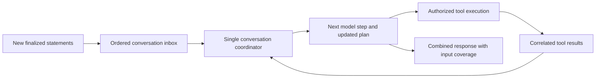

# One active agent with incoming statements and tool results

2026-11-22. [Prompt004](../../prompts/2026-11-22-004-check-single-agent-input-loop.md). Proposed next orchestration increment, IDEA-018 Discussing; no implementation/deployment approved by this question.

## What exists now

`VoiceSession.processingInput` permits one active voice input-processing batch. New finalized statements enter `pendingInput`; processing waits for active speech/outstanding finals and the prior batch. Pending text can be grouped within the existing request bound. Continuing speech suppresses an obsolete reply while accepted input processing finishes. A later batch calls the existing assistant backend, whose conversation lock, recent saved messages and tenant/mode memory form its context.

The current model adapter makes one `responses.create` call for a structured reply/facts object. It has no tool definitions or function-call/tool-result execution loop. Database writes are application code after model completion, not tools selected by the LLM. New input is not inserted into the request already awaiting its response. This is serial queued model work, not a persistent tool-aware planning run. Future batches can consider earlier stored context, but neither the queue nor current prompt guarantees a single combined acknowledgement/summary covering every statement.

Evidence: [queue/serialization](../../services/api/src/voice/session.mjs), [single model request](../../services/api/src/model.ts), [history/lock/persistence](../../services/api/src/assistant.ts), [retention checks](../../services/api/test/voice-retention.test.mjs). Six focused tests passed after a fresh TypeScript build. The initial local invocation used older compiled output and failed the latest reply-suppression assertion; rebuilding current source resolved that artifact mismatch. No runtime source, staging or user data was changed by this audit.

## Proposed behavior

One logical coordinator for the conversation owns an ordered inbox, tool execution ledger, pending input and response coverage. New speech is accepted while the coordinator is waiting for tools, without starting a second competing run. At the next model/tool boundary, it drains new finalized input, appends the correlated tool results, and asks the model to continue/revise the plan from the accumulated conversation state. These are successive model calls within the same logical run.

Before each side-effecting tool dispatch, check newer corrections/cancellations and authorization. Completed actions need stable execution IDs/idempotency and verified results so continuing the plan does not repeat them. Corrections cannot magically undo already completed actions; compensation/confirmation requirements must be explicit. Speak a combined answer once the coordinator has accounted for the relevant pending statements, while retaining interruption and stop/logout behavior.

A simpler alternative retains the current serial queue and adds explicit combined-response coverage to the next batch. The richer inbox/loop is appropriate when actual multi-step tool planning is introduced. Both require bounds/timeouts and an explicit policy for new instructions that conflict with an action already in progress.

Open choices: supported tool set and side effects, first loop implementation versus an explicit summary-only queue enhancement, durable/reconnect ownership, input coverage/acknowledgement policy and authorization/cancellation semantics. These are proposals, not claims about the deployed app. Existing tests verify queue conservation/serialization, not future tool-loop replanning or guaranteed summaries.
