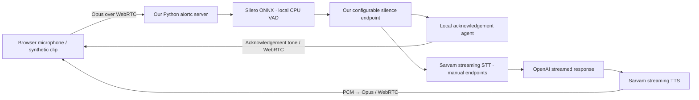

# Owned realtime voice-server POC

An isolated loopback experiment for IDEA-017 / TASK-018. No production backend, database, deployment or personal memory is used.



VAD identifies speech activity. The endpoint waits 320, 640 or 960 ms of non-speech; it does **not** determine semantic thought completion. All start/stop decisions here occur in our server. Cloud STT receives speech segments with a short pre-roll while the user is speaking; it does not wait to upload a complete recording.

## Run on this Windows checkout

Tested with Python 3.14 and the pinned binary packages in `requirements.lock.txt`. From this directory:

```powershell
python -m venv .local/venv
.\.local\venv\Scripts\python.exe -m pip install --only-binary=:all: -r requirements.lock.txt
.\.local\venv\Scripts\python.exe setup_model.py
.\.local\venv\Scripts\python.exe server.py
```

Open **http://127.0.0.1:4319**. Choose the route, endpoint preset, then **Start microphone** or **Replay synthetic speech**. Stop reply cancels generation and clears queued playback; new backend speech also triggers cancellation. End session closes microphone tracks, peer connection and provider resources. Sessions are limited to three minutes and one concurrent session. Restart with Ctrl+C if a test leaves a session occupied.

After setup, a shorter launcher is `./run.ps1` from this directory. Use `./run.ps1 -Cloud` to explicitly enable cloud mode for that run with the existing keys; this restores the prior process flag when the server exits and does not edit `.env`.

The setup downloads the pinned official Silero ONNX artifact, and `vad.py` verifies its SHA-256 before inference. Virtual environment, package cache, model and synthetic PCM remain ignored under `.local/`.

## Routes and access

- **Local routing proof:** no provider calls for live microphone audio; real VAD/endpoint/agent dispatch; returns an acknowledgement tone. It does not transcribe or answer the spoken question.
- **Cloud conversation:** existing privately configured `OPENAI_API_KEY` and `SARVAM_API_KEY`; OpenAI `gpt-6-luna` streamed text, Sarvam `saaras:v4` STT and `bulbul:v4-flash` TTS. Defaults to speaker `simran_en_customer`; optional `SARVAM_SPEAKER` overrides it.
- Cloud mode additionally requires `SARVAM_PRIVACY_CONFIRMED=true`. Audio is processed by Sarvam; transcripts go to OpenAI. Read only these selected variables from the existing private repository-root `.env`, with environment overrides. Never put keys in the browser, public files or chat. No new subscription, LiveKit project or Gemini key is required.
- During automated cloud verification, the privacy switch was set **only in the launched server process**, using synthetic input. Saved `.env` was not changed. A normal restart will keep cloud mode disabled unless the owner configures that switch privately.
- **Synthetic replay:** first creates the fixed phrase “Hello Victor. What is twelve times thirteen?” using OpenAI `gpt-4o-mini-tts`, then reuses ignored `.local/fixture.pcm`. This incurs a provider request on first generation even in local routing mode. No arbitrary text or human recording is saved. The browser clearly labels the voice as AI generated.

## Verification

With the server running:

```powershell
.\.local\venv\Scripts\python.exe -m unittest test_core -v
.\.local\venv\Scripts\python.exe check_webrtc.py --mode local
# Requires cloud mode enabled in the server process:
.\.local\venv\Scripts\python.exe check_webrtc.py --mode cloud
```

Seven focused checks cover actual ONNX silence rejection, pause tolerance/hysteresis, endpoint presets, clearing queued audio, cancellation before a stale reply, and suppression of superseded transcripts. The WebRTC checks send an actual synthetic speech track through ICE/DTLS/Opus, require backend boundary/agent events, and verify decoded non-silent return audio. Cloud acceptance requires a completed transcript and the correct arithmetic result. It is a functional fixture, not a statistical model evaluation.

`evidence-local.json` and `evidence-cloud.json` contain synthetic text and stage events only. The cloud run returned “12 times 13 is 156.” First server PCM arrived **3941 ms after our endpoint** in that one run, excluding the preceding 640 ms silence rule, client transport/playback and acoustic delay. No latency winner or smooth-conversation claim is justified by it. See the [experiment report](../12-owned-server-poc-report.md) for browser results and limitations.

## Limits before a production design

Loopback only: no public ICE/TURN, TLS/domain, authentication, tenant policy, shared database, durable memory, tool executor, multi-worker routing, reconnect recovery or capacity test. Do not expose this server publicly. Local owner cookies and same-origin checks only isolate this development experiment. No personal audio is written by this app; provider-side retention follows the account/service controls and is not proven disabled by this POC.

The client requests browser echo cancellation/noise suppression/AGC. Speaker echo, background speech, Bluetooth, Android lifecycle, real microphone permission/playback, actual human interruptions and Pixel acceptance still need device tests. Cancelling our queued PCM cannot retract audio already buffered in the browser or at the speaker. The UI’s PCM timing is server-stage latency, never mouth-to-ear latency.

Relevant primary references: [aiortc API](https://aiortc.readthedocs.io/en/latest/api.html), [Silero source](https://github.com/snakers4/silero-vad/tree/066409f3d9db45a30d21dfcbf9147826ffdd7052), [Sarvam realtime STT](https://docs.sarvam.ai/api/api-guides-tutorials/speech-to-text/realtime-streaming), [Sarvam streaming TTS](https://docs.sarvam.ai/api/api-guides-tutorials/text-to-speech/streaming-api/web-socket), [OpenAI Responses API](https://platform.openai.com/docs/api-reference/responses).
