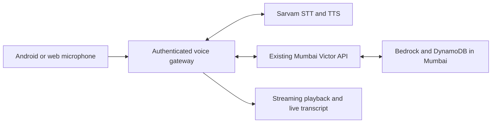

# Victor shared voice gateway

Source implementation for Sarvam speech on the existing Kotlin Android app and vanilla-JavaScript browser client. This service owns persistent speech connections; the existing API Gateway HTTP API does not provide an inbound streaming audio transport. No deployed gateway or live voice-quality result is claimed.

## Selected integration

- Official `sarvamai` JavaScript SDK 1.1.20, pinned in `package-lock.json`.
- Saaras v4 realtime STT, English (`en-IN`), 16kHz mono PCM16, partial results, VAD endpointing at an initial 650ms silence threshold.
- Bulbul v4 Flash, `simran_en_customer` as the initial audition voice, 24kHz WAV converted to PCM for streaming playback. The voice choice is a starting configuration, not an owner-approved quality verdict.
- Existing Cognito, Mumbai Bedrock, mode separation, memory extraction, and secret holds remain authoritative in the HTTP backend.
- Flutter SDK not used: it targets Sarvam Voice Agents, while Victor is Kotlin and already has its own conversation/memory backend.



## Run and verify locally

Use Node 22 or later. From this directory:

```text
npm ci --ignore-scripts
npm test
```

Copy `.env.example` to the ignored `.env`, configure it locally, then:

```text
node --env-file=.env server.mjs
```

Keep `SARVAM_API_KEY` only on the gateway server. Supply the public Mumbai Cognito user-pool ID/client ID, existing API URL, and exact browser origin. Before setting `SARVAM_PRIVACY_CONFIRMED=true`, an account owner must verify Model APIs retention is **No retention (0 days)** in Sarvam Settings → Workspace → Data policy, including the Model APIs override. The current docs say an unset retention period is indefinite and later changes are not retroactive. See the [research record](../docs/voice-research-2026-11-19.md).

The process intentionally refuses startup without the key, public settings, or privacy confirmation. Local HTTP health check: `/health`. WebSocket: `/voice`. Production requires a reviewed HTTPS/WSS reverse proxy or container endpoint. The browser and APK deliberately reject unsecured gateway URLs; localhost unit tests do not imply a deployed endpoint.

## Protocol and controls

The client connects to `/voice` and sends a single JSON `start` frame with its Cognito access token, fixed Personal/Practice mode, and optional conversation UUID. The server verifies the Cognito signature, Mumbai issuer, app client, access-token type and expiry before opening a paid speech connection. Tokens and vendor keys never appear in URLs or logs. Audio frames are little-endian PCM16, mono 16kHz, 100ms / 3,200 bytes. Controls: `mute`, `interrupt`, `stop`.

The gateway emits `ready`, `state`, `transcript`, `reply`, `audio`, `clear`, `speechEnd`, and sanitized `error` events. Audio output is mono PCM16 at 24kHz. A speech-start event cancels the prior generation and clears queued client playback. Interrupted TTS connections are closed; old-generation audio and late model results are discarded. Muting speech does not cancel a pending text answer. No audio replay or automatic paid-turn retry occurs after a disconnect.

The browser stops capture on tab hiding/page exit, mode switch, new chat, typed submission, and sign-out. Android stops on backgrounding, mode/new-chat changes, typed submission, and activity destruction. Both offer Start voice, Stop voice, Stop speaking, and Mute replies. Echo cancellation is requested; actual echo suppression needs device testing and headphones are included in the test matrix.

## Limits and cost accounting

- Five-minute gateway-enforced session limit, additionally bounded by the access-token expiry; one active connection per subject per gateway process; at most ten connections per process.
- PCM frame size/rate limits and playback backpressure bounds. Do not autoscale without revisiting per-owner connection coordination.
- Existing monthly DynamoDB allowance is used by authenticated `/voice/session` and `/voice/speech`. Listening reserves 10 US cents for a session; TTS reserves 2 cents per 1,000 characters rounded up; chat retains its existing reservation. These deliberately conservative estimates are not an invoice or hard provider/account spending cap. The voice conversion assumption is INR 60/USD; it is not an exchange-rate quotation. Failed attempts are not refunded.
- Sarvam charges are separate from the AWS account budget alerts. A persistent gateway also has hosting cost.
- No microphone audio/transcripts/replies/token payloads are logged or written by this service. Completed ordinary conversations are saved by the existing Victor API. AWS may continue an in-flight Lambda after the gateway cancels its HTTP request; an interrupted response may still incur cost and appear in history.

## Deployment remains separate

The Dockerfile builds the server only; `.env` and local dependencies are excluded. Publish a reviewed immutable image, supply the Sarvam key through the host's secret mechanism, and deploy a persistent WSS-capable gateway in Mumbai. ECS Express Mode is a candidate with a managed HTTPS URL, but creates billed Fargate/ALB/log/network resources. No hosting resources are provisioned by this README.

Set the backend SAM parameter `VoiceGatewayUrl` to the reviewed `wss://HOST/voice` endpoint. It defaults empty, keeping voice disabled. All three voice routes use the existing Cognito JWT authorizer. No new Sarvam key, AWS credential, or fourth property is required in `android/victor.properties`: the app fetches the public gateway URL from `/voice/config` after sign-in.

Review and approve the concrete AWS deployment change set under `aws-requirement.md`. Rebuild Android from the repository after the deployment. Validate genuine provider events, account model access, audio formats, latency, interruptions, budget holds, and Pixel/browser behavior before marking the feature complete.


## Owner's root env and synthetic test

The owner chose to keep the key in the Git-ignored repository-root `.env`, not this directory. For the explicit synthetic-only check, run from this directory:

```text
node --env-file=../.env live-check.mjs --synthetic
```

This makes paid provider calls using one fixed harmless phrase, writes a sample and metadata under ignored `.voice-local/`, and never opens a microphone. The first run generated 4.02 seconds of speech, received first PCM in 692ms including connection setup, and transcribed it correctly. It is not an end-to-end chat or voice-quality benchmark. The key has not been copied into this folder, clients, images, or records. Full server startup additionally needs the public settings and confirmed zero-retention flag described above. No production gateway is running.

The synthesis handshake is now prepared concurrently with the model answer. No reply text is sent for synthesis until the backend's ownership, secret-hold and allowance checks pass. Android source also requests foreground audio focus, preserves headset routing where present, and releases capture/playback/audio routing on stop; actual behavior still requires a Pixel build/test. [Android audio focus guidance](https://developer.android.com/media/optimize/audio-focus) applies to the current target SDK.
